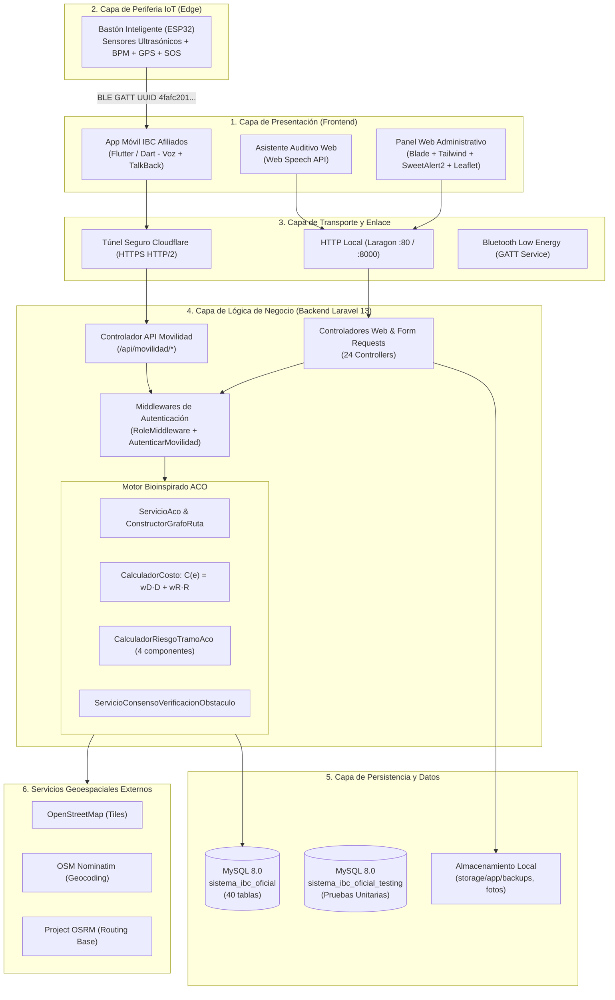

# BASE TÉCNICA PARA MANUAL DE INSTALACIÓN, CONFIGURACIÓN Y DESPLIEGUE DEL SISTEMA
**Proyecto Integrador Final Universitario**  
**Sistema:** SISTEMA ADMINISTRATIVO Y DE MOVILIDAD ASISTIDA IBC (SISTEMA-IBC-OFICIAL)  
**Institución Beneficiaria:** Instituto Boliviano de la Ceguera (IBC)  
**Repositorio Oficial:** `https://github.com/Nazareth75/SISTEMA-IBC-OFICIAL.git`  
**Ruta Local de Inspección:** `C:\laragon\www\SISTEMA-IBC-OFICIAL`  
**Fecha de Generación del Informe Técnico:** 14 de Noviembre de 2026  
**Documento Destino para ChatGPT:** Entrada estructurada exhaustiva para la elaboración de un Manual Profesional en formato Word (.docx).

---

> [!NOTE]
> **Propósito de este documento:**  
> Esta base técnica recopila toda la información de arquitectura, dependencias, base de datos, procedimientos de instalación paso a paso, comandos reales verificados, puertos, servicios externos, diagramas de evidencias y resolución de incidencias. Cada dato técnico cuenta con la ruta de respaldo dentro del código fuente del proyecto. Los datos que no pudieron ser verificados en el entorno se indican explícitamente como **NO VERIFICADO** para evitar cualquier tipo de alucinación.

---

## 1. ANÁLISIS GENERAL DEL PROYECTO

### 1.1 Nombre Real del Proyecto
- **Nombre en Repositorio:** `SISTEMA-IBC-OFICIAL` (Branch activa de inspección: `aco-revisiones`, commit `a74195f`).
- **Denominación Formal:** Sistema Web Administrativo Integral y Plataforma Tecnológica de Movilidad Peatonal Asistida con Optimización por Colonia de Hormigas (ACO) para el Instituto Boliviano de la Ceguera (IBC).
- **Nombre en `composer.json`:** `laravel/laravel` (Proyecto base derivado de Laravel 13).
- **Nombre en módulo móvil:** `ibc_movilidad` (`mobile/pubspec.yaml`, Package Android: `bo.ibc.ibc_movilidad`).
- **Respaldo:** [CLAUDE.md](file:///c:/laragon/www/SISTEMA-IBC-OFICIAL/CLAUDE.md#L1-L15), [contexto.md](file:///c:/laragon/www/SISTEMA-IBC-OFICIAL/contexto.md#L1-L17), [mobile/pubspec.yaml](file:///c:/laragon/www/SISTEMA-IBC-OFICIAL/mobile/pubspec.yaml#L1-L20).

### 1.2 Objetivo y Función Principal
El proyecto es una solución socio-tecnológica integral orientada a resolver dos grandes necesidades del Instituto Boliviano de la Ceguera:

1. **Gestión Administrativa e Institucional (ERP Social):**
   - Registro, filiación y expediente de Personas No Videntes (`personas_no_videntes`) y sus tutores legales (`tutores_contactos`).
   - Control del ciclo de vida de Afiliaciones (`afiliaciones`) con verificación automática de vigencia y vencimiento.
   - Administración del catálogo y asignación individual de Beneficios Sociales (`beneficios_sociales`, `asignacion_beneficios`).
   - Gestión de convenios institucionales (`instituciones_externas`), seguimiento de trámites (`tramites_instituciones`) y control de acceso a servicios médicos y de salud (`accesos_salud`).
   - Planificación de programas de formación y registro de participantes (`tipos_capacitacion`, `capacitaciones`, `participaciones_capacitacion`).
   - Accesibilidad web auditiva para directores o administradores no videntes mediante síntesis de voz Web Speech API integrada en el layout administrativo.

2. **Plataforma de Movilidad Peatonal Accesible e Inteligente (Ingeniería de Tráfico Peatonal + IoT):**
   - Levantamiento y estructuración topológica de vías y segmentos de calle (`calles_tramos`) asociados a Rutas Seguras (`rutas`).
   - Evaluación multivariable del riesgo vial en cada tramo: infraestructura física (`condiciones_entorno`), zonas críticas (`zonas_riesgo`), niveles normativos (`niveles_seguridad`) y obstáculos temporales o permanentes (`obstaculos`, `reportes_obstaculos`).
   - **Algoritmo de Optimización por Colonia de Hormigas (ACO):** Metaheurística bioinspirada multiobjetivo ejecutada en el backend Laravel que balancea la distancia física contra el riesgo peatonal ponderado ($C(e) = w_D \cdot D_{norm} + w_R \cdot R_{norm}$), favoreciendo trayectos más seguros antes que trayectos estrictamente más cortos.
   - Validación y consenso colaborativo comunitario: los voluntarios reportan y verifican el estado de obstáculos en terreno; dos verificaciones independientes generan consenso para que un técnico oficialice la resolución y el sistema invalide y recalcule automáticamente las rutas óptimas.
   - **Aplicación Móvil Accesible (Flutter):** Diseñada exclusivamente con interfaz hablada accesible (TalkBack, reconocimiento de voz para dictar carnet de identidad dígito por dígito y confirmación de comandos por voz sin campos de texto convencionales).
   - **Integración con Hardware IoT (Bastón Blanco Inteligente):** Comunicación directa por Bluetooth Low Energy (BLE) entre la app Flutter y un microcontrolador ESP32 con sensores ultrasónicos de proximidad, pulsómetro (BPM) y botón de alerta SOS ante emergencias.

- **Respaldo:** [contexto.md](file:///c:/laragon/www/SISTEMA-IBC-OFICIAL/contexto.md#L7-L17), [docs/aco/analisis_aco.ipynb](file:///c:/laragon/www/SISTEMA-IBC-OFICIAL/docs/aco/analisis_aco.ipynb), [app/Services/Aco/CalculadorCosto.php](file:///c:/laragon/www/SISTEMA-IBC-OFICIAL/app/Services/Aco/CalculadorCosto.php#L8-L30), [mobile/README.md](file:///c:/laragon/www/SISTEMA-IBC-OFICIAL/mobile/README.md#L1-L44).

### 1.3 Lenguajes de Programación Utilizados

| Lenguaje | Ámbito de Aplicación | Versión Verificada | Respaldo en Proyecto |
| :--- | :--- | :--- | :--- |
| **PHP** | Backend web, controladores, modelos Eloquent, servicios del algoritmo ACO y API REST | 8.3.6 (NTS x64) / `^8.3` | [composer.json](file:///c:/laragon/www/SISTEMA-IBC-OFICIAL/composer.json#L9) |
| **JavaScript (ES6+)** | Interactividad en vistas Blade, control del DOM, mapa interactivo Leaflet y asistente Web Speech | ES2022+ / Bundled por Vite | [package.json](file:///c:/laragon/www/SISTEMA-IBC-OFICIAL/package.json#L18), [public/js/mapa-aco.js](file:///c:/laragon/www/SISTEMA-IBC-OFICIAL/public/js/mapa-aco.js) |
| **Dart** | Aplicación móvil para afiliados con discapacidad visual (Android) | Dart SDK `^3.12.2` | [mobile/pubspec.yaml](file:///c:/laragon/www/SISTEMA-IBC-OFICIAL/mobile/pubspec.yaml#L21-L23) |
| **SQL** | Definición y manipulación del esquema relacional en MySQL | MySQL 8.0.30 | [storage/app/backups/backup_sistema_ibc_2026-06-20_15-15-37.sql](file:///c:/laragon/www/SISTEMA-IBC-OFICIAL/storage/app/backups/backup_sistema_ibc_2026-06-20_15-15-37.sql#L1) |
| **Python** | Experimentación matemática, modelado de feromonas y generación de gráficas de convergencia | Python 3.10 | [docs/aco/analisis_aco.ipynb](file:///c:/laragon/www/SISTEMA-IBC-OFICIAL/docs/aco/analisis_aco.ipynb) |
| **Blade** | Motor de plantillas HTML dinámicas con directivas de autorización | Integrado en Laravel 13 | [resources/views/layouts/app.blade.php](file:///c:/laragon/www/SISTEMA-IBC-OFICIAL/resources/views/layouts/app.blade.php) |
| **C / C++** (Firmware) | Código del microcontrolador ESP32 del bastón inteligente (protocolo BLE GATT) | NO VERIFICADO en repo (firmware flasheado en hardware físico) | Protocolo decodificado en [mobile/lib/baston_protocol.dart](file:///c:/laragon/www/SISTEMA-IBC-OFICIAL/mobile/lib/baston_protocol.dart#L1-L35) |
| **PowerShell / Batch** | Scripts de orquestación, puesta en marcha local y túneles Cloudflare | PowerShell 5.1 / 7+ y Windows Batch | [INICIAR_SISTEMA_IBC.bat](file:///c:/laragon/www/SISTEMA-IBC-OFICIAL/INICIAR_SISTEMA_IBC.bat), [servir-lan.ps1](file:///c:/laragon/www/SISTEMA-IBC-OFICIAL/servir-lan.ps1) |

### 1.4 Frameworks y Versiones

| Componente | Framework / Librería | Versión Exacta en Código | Función Principal |
| :--- | :--- | :--- | :--- |
| **Backend Core** | Laravel Framework | **13.5.0** (Constraint `^13.0`) | Framework MVC central de la aplicación |
| **Autenticación** | Laravel Breeze | **2.4** (Scaffolding Blade) | Gestión de sesiones, login, password resets |
| **Pruebas Backend**| PHPUnit | **12.5.12** | Suite de pruebas unitarias automatizadas |
| **Estilos CSS** | Tailwind CSS | **3.1.0** / **4.0.0** (`@tailwindcss/vite`) + CDN | Diseño visual con paleta corporativa IBC |
| **Bundler Frontend**| Vite | **8.0.0** (`laravel-vite-plugin: ^3.0.0`) | Compilación de assets JavaScript y CSS |
| **Componentes UI** | Alpine.js | **3.4.2** | Reactividad ligera en menús y modales |
| **Cliente HTTP Web**| Axios | **1.15.0** | Peticiones asíncronas AJAX en vistas Blade |
| **Alertas UI** | SweetAlert2 | **11.26.24** + CDN v11 | Diálogos de confirmación y toasts flash |
| **Cartografía Web** | Leaflet JS | **1.9.4** (CDN unpkg) | Renderizado de capas geográficas y rutas |
| **Móvil Core** | Flutter Framework | Compatible con SDK `>=3.12.2` | Aplicación móvil multiplataforma (Android) |
| **Cartografía Móvil**| Flutter Map + LatLong2 | `flutter_map: ^8.3.2`, `latlong2: ^0.10.1` | Renderizado de tramos viales en teléfono |
| **Síntesis Móvil** | Flutter TTS | `^4.2.5` | Locución auditiva de instrucciones y menú |
| **Geolocalización** | Geolocator | `^14.1.1` | Posicionamiento GPS peatonal en navegación |
| **Bluetooth IoT** | Flutter Blue Plus | `^2.3.14` | Conectividad BLE con bastón ESP32 |

- **Respaldo:** [composer.json](file:///c:/laragon/www/SISTEMA-IBC-OFICIAL/composer.json#L8-L21), [package.json](file:///c:/laragon/www/SISTEMA-IBC-OFICIAL/package.json#L9-L23), [mobile/pubspec.yaml](file:///c:/laragon/www/SISTEMA-IBC-OFICIAL/mobile/pubspec.yaml#L30-L44).

### 1.5 Herramientas y Programas Necesarios
1. **Laragon (Entorno de Servidor Local):** Paquete integrado para Windows que agrupa Apache HTTP Server 2.4.54, PHP 8.3.6 (NTS x64) y MySQL 8.0.30.
2. **Composer:** Gestor de paquetes a nivel de aplicación para PHP (v2.x).
3. **Node.js y npm:** Entorno de ejecución JavaScript para compilar los assets con Vite (Node 18 o superior).
4. **Git:** Sistema de control de versiones distribuido.
5. **Flutter SDK & Android Studio:** Entorno para compilar el archivo `.apk` de la aplicación móvil (`mobile/`).
6. **Cloudflared CLI:** Binario de Cloudflare Tunnel para publicar la API local hacia Internet bajo protocolo seguro HTTPS (HTTP/2) sin necesidad de redireccionar puertos en routers residenciales ni disponer de IP pública fija.
7. **HeidiSQL / phpMyAdmin:** Clientes visuales para administración de la base de datos MySQL (incluidos en Laragon).
8. **Navegador Web Moderno:** Google Chrome, Microsoft Edge o Mozilla Firefox con soporte para Web Speech API (síntesis de voz en español).

### 1.6 Arquitectura del Sistema
El sistema implementa una **Arquitectura en Capas Híbrida (Monolito Modular + API REST + Edge IoT)**:



- **Respaldo:** [bootstrap/app.php](file:///c:/laragon/www/SISTEMA-IBC-OFICIAL/bootstrap/app.php#L7-L22), [routes/web.php](file:///c:/laragon/www/SISTEMA-IBC-OFICIAL/routes/web.php), [routes/api.php](file:///c:/laragon/www/SISTEMA-IBC-OFICIAL/routes/api.php), [INICIAR_SISTEMA_IBC.bat](file:///c:/laragon/www/SISTEMA-IBC-OFICIAL/INICIAR_SISTEMA_IBC.bat), [app/Services/Aco/ServicioAco.php](file:///c:/laragon/www/SISTEMA-IBC-OFICIAL/app/Services/Aco/ServicioAco.php).

---

## 2. REQUISITOS PARA INSTALAR EL SISTEMA

### 2.1 Sistemas Operativos Compatibles
- **Servidor Web y Backend:**
  - **Soporte Primario Comprobado:** Windows 10 / Windows 11 (64-bit) con entorno Laragon.
  - **Soporte Teórico Equivalente:** GNU/Linux (Ubuntu Server 22.04 LTS / 24.04 LTS o Debian 12) utilizando stack Nginx/Apache + PHP 8.3-fpm + MySQL 8.0.
  - **macOS:** macOS Sonoma / Sequoia utilizando Homebrew o Laravel Herd.
- **Cliente Móvil (App Afiliado):**
  - Android 7.0 (Nougat, API nivel 24) hasta Android 14 (API 34). Configurado con `minSdk = 24`, `targetSdk = 34` ([mobile/android/app/build.gradle.kts](file:///c:/laragon/www/SISTEMA-IBC-OFICIAL/mobile/android/app/build.gradle.kts#L22-L23)).

### 2.2 Programas y Software Necesarios
1. **Laragon 6.0+ (Full o Portable para Windows):**
   - Apache 2.4.54 (Win64 VS16).
   - PHP 8.3.6 (NTS Win32-vs16-x64).
   - MySQL Community Server 8.0.30 (Winx64).
2. **Composer 2.x:** Gestor oficial de dependencias PHP.
3. **Node.js (v18.x LTS o v20.x/v24.x) & npm:** Para compilación de bundles con Vite.
4. **Git para Windows:** Para clonación de código y control de versiones.
5. **Cloudflared CLI (Opcional para Pruebas Remotas Móviles):** Binario `cloudflared.exe` para túnel HTTPS seguro hacia el teléfono celular.
6. **Flutter SDK 3.x con Dart SDK >= 3.12.2 (Opcional para compilación móvil):** Requerido únicamente si se desea generar nuevos archivos `.apk` desde el código fuente de `mobile/`.

### 2.3 Versiones de Software y Dependencias

#### Dependencias Backend PHP (`composer.json`)
- `php`: `^8.3`
- `laravel/framework`: `^13.0` (Instalada: **13.5.0**)
- `laravel/tinker`: `^3.0`
- `laravel/breeze`: `^2.4` (Entorno Dev)
- `phpunit/phpunit`: `^12.5.12` (Entorno Dev)
- `laravel/pail`: `^1.2.5`
- `laravel/pint`: `^1.27`
- **Extensiones PHP Requeridas en `php.ini`:**
  - `extension=pdo_mysql` (Conexión con base de datos)
  - `extension=mbstring` (Procesamiento de texto UTF-8)
  - `extension=openssl` (Cifrado de sesiones y tokens)
  - `extension=curl` (Consumo de APIs Nominatim y OSRM)
  - `extension=fileinfo` (Validación de subida de imágenes y documentos)
  - `extension=gd` (Procesamiento de fotos y reportes)
  - `extension=zip` (Backups comprimidos y Composer)

#### Dependencias Frontend JavaScript (`package.json`)
- `@tailwindcss/vite`: `^4.0.0`
- `tailwindcss`: `^3.1.0`
- `vite`: `^8.0.0`
- `laravel-vite-plugin`: `^3.0.0`
- `alpinejs`: `^3.4.2`
- `axios`: `^1.15.0`
- `sweetalert2`: `^11.26.24`
- `concurrently`: `^9.0.1`

#### Dependencias Móviles Flutter (`mobile/pubspec.yaml`)
- `flutter`: `sdk: flutter`
- `flutter_map`: `^8.3.2`
- `latlong2`: `^0.10.1`
- `flutter_tts`: `^4.2.5`
- `geolocator`: `^14.1.1`
- `flutter_blue_plus`: `^2.3.14`
- `uuid`: `^4.6.0`
- `http`: `^1.6.0`

### 2.4 Requisitos Mínimos y Recomendados de Hardware

| Componente | Requisito Mínimo (Demostración) | Requisito Recomendado (Desarrollo y Compilación) |
| :--- | :--- | :--- |
| **Procesador (CPU)** | Intel Core i3 / AMD Ryzen 3 (2 núcleos, 2.0 GHz) | Intel Core i5 / i7 o AMD Ryzen 5 / 7 (4+ núcleos) |
| **Memoria RAM** | 4 GB | 8 GB a 16 GB (necesario si se compila Android Gradle) |
| **Almacenamiento** | 5 GB libres en SSD | 20 GB libres en SSD (para cache de Flutter, SDK y Node) |
| **Smartphone** | Android 7.0, 2 GB RAM, GPS, Bluetooth 4.2 | Android 10+, 4 GB RAM, GPS preciso, Bluetooth 5.0 BLE |
| **Microcontrolador** | ESP32-WROOM-32 (240 MHz Dual Core, 520 KB SRAM, BLE v4.2 BR/EDR) | Módulo ESP32 con antena cerámica y alimentación 3.7V LiPo |

### 2.5 Servicios Externos Necesarios
1. **OpenStreetMap Tile Server (`https://{s}.tile.openstreetmap.org/{z}/{x}/{y}.png`):** Proveedor gratuito de teselas cartográficas para renderizar el mapa en la interfaz web administrativa y en la aplicación Flutter.
2. **OSM Nominatim API (`https://nominatim.openstreetmap.org`):** Motor de búsqueda inversa y geocodificación de coordenadas y direcciones urbanas ([.env.example](file:///c:/laragon/www/SISTEMA-IBC-OFICIAL/.env.example#L65-L66)).
3. **Project OSRM Routing Engine (`https://router.project-osrm.org`):** Motor de cálculo de trayectos peatonales de referencia sobre la red vial pública ([.env.example](file:///c:/laragon/www/SISTEMA-IBC-OFICIAL/.env.example#L67)).
4. **Cloudflare Quick Tunnels (`trycloudflare.com`):** Servicio de túnel dinámico cero-configuración para generar un host temporal `https://*.trycloudflare.com` que apunta al puerto local 8016 del backend.

### 2.6 Conexión a Internet
- **Fase de Instalación:** **OBLIGATORIA.** Necesaria para descargar dependencias vía Composer, npm, paquetes Gradle de Android y fuentes tipográficas Google Fonts / CDN SweetAlert.
- **Fase de Ejecución Web:** **OBLIGATORIA.** Para cargar teselas de OpenStreetMap, iconografía FontAwesome y realizar llamadas a OSRM/Nominatim.
- **Fase de Ejecución Móvil:** **HÍBRIDA / RESILIENTE.**
  - *Con conexión:* Permite autenticar el carnet, consultar el catálogo en tiempo real, descargar recomendaciones actualizadas y transmitir reportes y alertas SOS al servidor.
  - *Sin conexión:* La app conserva la última ruta descargada cifrada en almacenamiento seguro y retiene eventos en cola local hasta que se restablezca la conectividad.

---

## 3. ESTRUCTURA REAL DEL PROYECTO

### 3.1 Árbol de Carpetas Principales

```
C:\laragon\www\SISTEMA-IBC-OFICIAL\
├── .env                              # Archivo de variables de entorno del entorno local
├── .env.example                      # Plantilla oficial de variables de entorno
├── app/                              # Código fuente central del backend PHP
│   ├── Http/
│   │   ├── Controllers/              # 24 Controladores Resource, Movilidad, Backups y Logs
│   │   │   ├── Auth/                 # Controladores de Breeze (Login, Password, Profile)
│   │   │   ├── PersonaNoVidenteController.php
│   │   │   ├── TutorContactoController.php
│   │   │   ├── AfiliacionController.php
│   │   │   ├── BeneficioController.php
│   │   │   ├── AsignacionBeneficioController.php
│   │   │   ├── InstitucionExternaController.php
│   │   │   ├── TramiteInstitucionController.php
│   │   │   ├── AccesoSaludController.php
│   │   │   ├── CapacitacionController.php
│   │   │   ├── RutaController.php
│   │   │   ├── TramoController.php
│   │   │   ├── ObstaculoController.php
│   │   │   ├── ReporteObstaculoController.php
│   │   │   ├── VerificacionObstaculoController.php
│   │   │   ├── MovilidadController.php       # Endpoints dedicados para la app Flutter
│   │   │   ├── BackupController.php          # Generador y restaurador de dumps SQL
│   │   │   └── LogController.php             # Visor de logs del sistema
│   │   ├── Middleware/
│   │   │   ├── RoleMiddleware.php            # Verificación de roles (ADMINISTRADOR, TECNICO, etc.)
│   │   │   └── AutenticarMovilidad.php       # Verificación de tokens Bearer de la app móvil
│   │   └── Requests/                         # Form Requests para validación estricta
│   ├── Models/                               # 26 Modelos Eloquent con relaciones y borrado lógico
│   │   ├── User.php, Role.php, PersonaNoVidente.php, TutorContacto.php, Afiliacion.php,
│   │   ├── Ruta.php, CalleTramo.php, CondicionEntorno.php, EvaluacionRiesgo.php,
│   │   ├── Obstaculo.php, ReporteObstaculo.php, VerificacionObstaculo.php,
│   │   └── TokenMovilidad.php, EventoBaston.php, etc.
│   └── Services/                             # Capa de Lógica de Negocio Avanzada
│       ├── IdentificacionMovil.php           # Autenticación móvil por CI único activo
│       ├── RutaEstimacionService.php         # Interfaz con OSRM para métricas viarias
│       ├── TramoRiskService.php              # Servicio evaluador de perfil de riesgo de tramos
│       ├── AsistenteRutaService.php          # Estructuración de datos para síntesis por voz
│       └── Aco/                              # Implementación completa del Algoritmo ACO
│           ├── ServicioAco.php               # Orquestador del ciclo de hormigas y feromonas
│           ├── CalculadorCosto.php           # Función de costo multiobjetivo canónica
│           ├── CalculadorRiesgoTramoAco.php  # Agregador de 4 dimensiones de riesgo vial
│           ├── ConstructorGrafoRuta.php      # Conversión de tramos a grafo topológico
│           ├── Grafo.php, Arista.php, EstadoAcoRuta.php, ResultadoAco.php
│           └── ServicioConsensoVerificacionObstaculo.php # Lógica de consenso colaborativo
├── bootstrap/
│   └── app.php                       # Configuración de routing, middlewares y health check
├── config/                           # Archivos de configuración de Laravel (database, app, auth)
├── database/
│   ├── data/                         # Datasets geoespaciales JSON de prueba y demostración
│   │   ├── demo-la-paz.json
│   │   └── ibc-merced-previa.json    # Coordenadas geográficas de la Ruta La Merced (RUT-004)
│   ├── migrations/                   # 41 Migraciones de base de datos numeradas cronológicamente
│   └── seeders/                      # Pobladores de base de datos (Roles, Admin, Afiliados, Rutas)
├── docs/                             # Documentación técnica y análisis experimental
│   ├── aco/                          # Notebook de análisis matemático y figuras generadas
│   │   ├── analisis_aco.ipynb        # Cuaderno Jupyter con validación experimental de ACO
│   │   └── figuras/                  # Gráficas de convergencia y evolución de feromonas (.png)
│   ├── AUDITORIA_FLUJO_MOVIL.md      # Auditoría técnica de seguridad y accesibilidad móvil
│   └── INFORME-CONECTAR-CON-LA-APP.md # Informe de pruebas con datos móviles y túnel HTTPS
├── mobile/                           # Proyecto completo de la Aplicación Móvil en Flutter
│   ├── lib/
│   │   ├── main.dart                 # Interfaz visual accesible, voz, teclado y ciclo de vida
│   │   ├── api.dart                  # Cliente HTTP contra el backend Laravel
│   │   ├── baston_protocol.dart      # Decodificador del protocolo BLE (DIST, BPM, GPS, SOS)
│   │   ├── actualizacion_ruta.dart   # Comparador diferencial de rutas en tiempo real
│   │   └── configuracion.dart        # Variables de compilación y validación de URLs
│   ├── android/                      # Configuración nativa Android (Gradle Kotlin DSL)
│   └── pubspec.yaml                  # Dependencias y metadata del proyecto móvil
├── public/                           # Directorio raíz público expuesto por el servidor web
│   ├── index.php                     # Punto de entrada estándar de Laravel
│   ├── js/                           # Scripts frontend especializados
│   │   ├── mapa-aco.js               # Renderizado de tramos, grosor por riesgo y feromonas
│   │   ├── asistente-rutas.js        # Locución de rutas para administradores no videntes
│   │   └── navegacion-accesible.js   # Manejo de atajos y navegación auditiva
│   └── storage/                      # Enlace simbólico a almacenamiento de fotos y archivos
├── resources/
│   ├── views/                        # Vistas Blade del sistema organizadas modularmente
│   │   ├── layouts/app.blade.php     # Layout principal con navegación, SweetAlert2 y Voice Assistant
│   │   ├── personas_no_videntes/     # Módulo de afiliados y personas con discapacidad visual
│   │   ├── rutas/                    # Módulo de rutas seguras, tramos y mapas ACO
│   │   ├── reportes_obstaculos/      # Bandeja de reportes ciudadanos y comunitarios
│   │   ├── dashboard/                # Dashboards diferenciados por rol (Admin, Técnico, Voluntario)
│   │   └── components/voice-assistant.blade.php # Asistente de voz interactivo para no videntes
├── routes/
│   ├── web.php                       # Todas las rutas administrativas, módulos y APIs AJAX
│   ├── api.php                       # Rutas protegidas para el cliente móvil (/api/movilidad/*)
│   └── auth.php                      # Rutas de autenticación Laravel Breeze
├── storage/
│   ├── app/backups/                  # Directorio de copias de seguridad de la base de datos (.sql)
│   │   └── backup_sistema_ibc_2026-06-20_15-15-37.sql # Dump verificado de base de datos
│   └── logs/laravel.log              # Bitácora de errores y eventos del backend
├── tests/
│   └── Unit/                         # 206 Pruebas unitarias que certifican la integridad del sistema
├── INICIAR_SISTEMA_IBC.bat           # Script Batch de arranque rápido (Servidor 8016 + Cloudflare)
├── router-app.php                    # Router PHP especializado para servir endpoints móviles
├── servidor-lan.php                  # Router PHP para servir la app en red de área local (LAN)
└── servir-lan.ps1                    # Script PowerShell para detección de IP LAN y arranque
```

### 3.2 Archivos Clave y su Propósito Específico

| Archivo | Ruta Relativa | Propósito Técnico |
| :--- | :--- | :--- |
| **Punto de Entrada Móvil** | `router-app.php` | Filtra peticiones entrantes para permitir únicamente `/api/movilidad/*`, `/up` y descarga del `.apk`. Oculta `/phpmyadmin` y vistas web para seguridad cuando se expone vía túnel. |
| **Script de Puesta en Marcha** | `INICIAR_SISTEMA_IBC.bat` | Lanza PHP Built-in Server en `127.0.0.1:8016` con `router-app.php` e inicia el túnel `cloudflared` hacia Internet. |
| **Router LAN** | `servidor-lan.php` | Atiende peticiones estáticas (`.js`, `.css`, imágenes) y enruta tráfico a `public/index.php` para pruebas Wi-Fi dentro de la red local. |
| **Script LAN** | `servir-lan.ps1` | Detecta la dirección IP IPv4 de la computadora en la red Wi-Fi y levanta el servidor en el puerto 8000 para enlazar emuladores o teléfonos locales. |
| **Kernel / Bootstrap** | `bootstrap/app.php` | Configura el enrutamiento (`web`, `api`, `console`), los middlewares `role` y `movilidad`, y el health check `/up`. |
| **Servicio ACO Central** | `app/Services/Aco/ServicioAco.php` | Ejecuta la simulación de feromonas, cálculo de probabilidades por hormiga y convergencia hacia el camino de menor costo. |
| **Función de Costo** | `app/Services/Aco/CalculadorCosto.php` | Implementa $C(e) = 0.20 \cdot D_{norm} + 0.80 \cdot R_{norm}$, priorizando la integridad de la persona ciega sobre la distancia. |
| **Agregador de Riesgo** | `app/Services/Aco/CalculadorRiesgoTramoAco.php` | Agrega 4 variables: evaluación técnica (25%), condiciones del entorno (25%), zonas de riesgo (25%) y obstáculos activos (25%). Rechaza datos faltantes (`SIN_DATOS ≠ 0.0`). |
| **Protocolo Bastón BLE** | `mobile/lib/baston_protocol.dart` | Parsea las tramas emitidas por el bastón ESP32: distancias de obstáculos (`DIST:d1,d2,d3`), frecuencia cardíaca (`BPM:v`) y emergencias (`SOS`). |
| **Asistente de Voz Web** | `resources/views/components/voice-assistant.blade.php` | Componente Blade de 67 KB con motor de comandos auditivos para navegar por el sistema sin monitor. |

---

## 4. BASE DE DATOS

### 4.1 Motor y Configuración
- **Motor de Base de Datos:** MySQL Community Server 8.0.30 x64.
- **Juego de Caracteres y Cotejamiento:** `utf8mb4` / `utf8mb4_unicode_ci`.
- **Motor de Almacenamiento Predeterminado:** InnoDB (soporte transaccional ACID y restricciones de integridad foránea).

### 4.2 Nombres de Bases de Datos
1. **Base de Datos Oficial / Operativa:** `sistema_ibc_oficial` (Configurada en `.env` local).
   - *Nota histórica:* En la documentación inicial ([CLAUDE.md](file:///c:/laragon/www/SISTEMA-IBC-OFICIAL/CLAUDE.md#L12)) se denominaba `ibc_admin`; en el entorno real se encuentra formalizada como `sistema_ibc_oficial`.
2. **Base de Datos para Pruebas Automatizadas:** `sistema_ibc_oficial_testing` (Declarada en [phpunit.xml](file:///c:/laragon/www/SISTEMA-IBC-OFICIAL/phpunit.xml#L27) y utilizada en las 206 pruebas unitarias para no alterar los registros oficiales).

### 4.3 Archivos de Respaldo Existentes
- **Ubicación:** `storage/app/backups/backup_sistema_ibc_2026-06-20_15-15-37.sql`
- **Características:** Volcado SQL generado mediante `mysqldump` con 1,260 líneas de código SQL que incluye estructuras de tablas e inserciones iniciales.
- **Generador de Respaldos:** El sistema cuenta con su propio módulo de administración de copias de seguridad en [BackupController.php](file:///c:/laragon/www/SISTEMA-IBC-OFICIAL/app/Http/Controllers/BackupController.php) accesible en la ruta web `/admin/backups`.

### 4.4 Tablas del Sistema (40 Tablas Verificadas)

| # | Nombre de la Tabla | Módulo / Función Principal | Clave Primaria / Campo Clave |
| :--- | :--- | :--- | :--- |
| 1 | `users` | Usuarios del sistema con autenticación Laravel Breeze | `id` |
| 2 | `roles` | Catálogo de roles (`SUPERADMINISTRADOR`, `ADMINISTRADOR`, `TECNICO`, `VOLUNTARIO`) | `id` |
| 3 | `usuarios` | Tabla extendida de datos de funcionarios/usuarios institucionales | `cod_usuarios` |
| 4 | `parametros_sistema` | Parámetros globales de configuración del sistema | `id` |
| 5 | `personas_no_videntes` | Padrón de personas con discapacidad visual registradas | `cod_personas_no_videntes` (`ide_pnv`) |
| 6 | `tutores_contactos` | Familiares, tutores legales y contactos de emergencia | `id` (`cod_tutores_contactos`) |
| 7 | `tipos_afiliado` | Categorización institucional de afiliaciones | `cod_tipos_afiliado` |
| 8 | `afiliaciones` | Registro formal de afiliación al IBC con estado y fecha vencimiento | `cod_afiliaciones` (`ide_afi`) |
| 9 | `federaciones` | Registro de federaciones departamentales de personas ciegas | `cod_federaciones` |
| 10 | `afiliaciones_federaciones` | Tabla intermedia entre afiliaciones y federaciones | `id` |
| 11 | `beneficios_sociales` | Catálogo de beneficios sociales (económicos, materiales, salud) | `cod_beneficios_sociales` |
| 12 | `asignacion_beneficios`| Asignación efectiva de beneficios a un afiliado | `cod_asignacion_beneficios` |
| 13 | `instituciones_externas`| Directorio de instituciones colaboradoras (centros de salud, ministerios) | `cod_instituciones_externas` |
| 14 | `tramites_instituciones`| Solicitudes y trámites gestionados ante entidades externas | `id` (`cod_tramites_instituciones`) |
| 15 | `accesos_salud` | Registros de atención y acceso a centros hospitalarios | `cod_accesos_salud` |
| 16 | `tipos_capacitacion` | Tipos de cursos (Braille, orientación y movilidad, computación) | `id` (`cod_tipos_capacitacion`) |
| 17 | `capacitaciones` | Cursos y talleres organizados por el IBC | `id` (`cod_capacitaciones`, `ide_cap`) |
| 18 | `participaciones_capacitacion` | Inscripciones y calificaciones de afiliados en cursos | `id` |
| 19 | `niveles_seguridad` | Escala normativa de seguridad vial (1 a 5, colores hex) | `cod_niveles_seguridad` |
| 20 | `rutas` | Rutas peatonales urbanas asistidas | `cod_rutas` (`ide_rut`) |
| 21 | `calles_tramos` | Tramos viales físicos individuales (origen, fin, tipo vía, longitud) | `cod_calles_tramos` |
| 22 | `ruta_calles_tramos` | Tabla pivote de ordenamiento y conexión entre rutas y tramos viales | `id` |
| 23 | `condiciones_entorno`| Evaluación de aceras, semáforos sonoros, iluminación y superficie | `cod_condiciones_entorno` |
| 24 | `zonas_riesgo` | Zonas de peligro adyacentes a tramos (construcciones, comercio informal) | `cod_zonas_riesgo` |
| 25 | `obstaculos` | Catálogo de obstáculos físicos registrados en tramos | `cod_obstaculos` |
| 26 | `reportes_obstaculos` | Reportes de obstáculos levantados en terreno o por app móvil | `id` (`cod_reporte_obstaculos`) |
| 27 | `verificaciones_obstaculos` | Votos y verificaciones colaborativas de voluntarios en campo | `id` |
| 28 | `evaluaciones_riesgo`| Evaluaciones técnicas del nivel de seguridad vial por tramo | `cod_evaluaciones_riesgo` |
| 29 | `recorridos_realizados`| Bitácora de trayectos peatonales ejecutados | `cod_recorridos_realizados` |
| 30 | `experiencias_usuario`| Calificación y retroalimentación de accesibilidad por afiliados | `cod_experiencias_usuario` |
| 31 | `tokens_movilidad` | Tokens revocables de sesión móvil cifrados con Android Keystore | `id` |
| 32 | `eventos_baston` | Eventos telemétricos emitidos por el bastón (obstáculo ultrasónico, SOS) | `id` |
| 33 | `sessions` | Sesiones de usuario web gestionadas en base de datos | `id` |
| 34 | `cache` | Cache de consultas y recomendaciones ACO en base de datos | `key` |
| 35 | `cache_locks` | Bloqueos atómicos de concurrencia para cache | `key` |
| 36 | `jobs` | Cola de trabajos asíncronos en segundo plano | `id` |
| 37 | `job_batches` | Lotes de procesamiento de trabajos en segundo plano | `id` |
| 38 | `failed_jobs` | Registro de fallos en ejecución de colas | `id` |
| 39 | `password_reset_tokens`| Tokens temporales para recuperación de contraseñas | `email` |
| 40 | `migrations` | Historial de las 41 migraciones ejecutadas en el sistema | `id` |

- **Respaldo:** [EVIDENCIAS_MANUAL/08_evidencia_tablas_mysql.txt](file:///c:/laragon/www/SISTEMA-IBC-OFICIAL/EVIDENCIAS_MANUAL/08_evidencia_tablas_mysql.txt).

### 4.5 Reglas de Nomenclatura Estricta en Base de Datos
El proyecto utiliza una convención propia de sufijos abreviados de 3 letras que representan la tabla. **Nunca debe alterarse esta nomenclatura en consultas ni modelos:**
- `*_pnv`: Personas No Videntes (`nom_pnv`, `app_pnv`, `cii_pnv`, `gdi_pnv`, `fbj_pnv`).
- `*_tco`: Tutores y Contactos (`nom_tco`, `tel_tco`, `etl_tco`, `fbj_tco`).
- `*_afi`: Afiliaciones (`ide_afi`, `fec_afi`, `fve_afi`, `est_afi`, `fbj_afi`).
- `*_bso`: Beneficios Sociales (`nom_bso`, `tip_bso`, `est_bso`).
- `*_iex`: Instituciones Externas (`nom_iex`, `tip_iex`, `act_iex`).
- `*_tin`: Trámites Institucionales (`tti_tin`, `est_tin`, `fei_tin`, `fer_tin`).
- `*_rut`: Rutas Seguras (`ide_rut`, `nom_rut`, `ori_rut`, `dst_rut`, `est_rut`).
- `*_ctr`: Calles y Tramos (`nom_ctr`, `lon_ctr`, `geo_ctr`).
- `fbj_*`: Fecha de Baja (campo timestamp para **borrado lógico**, p. ej. `fbj_pnv`). Los modelos no aplican `DELETE` físico.

### 4.6 Procedimiento para Crear la Base de Datos

#### Opción A: Mediante Consola de MySQL (Laragon Terminal)
```bash
# Abrir terminal de MySQL
mysql -u root

# Crear la base de datos oficial
CREATE DATABASE sistema_ibc_oficial CHARACTER SET utf8mb4 COLLATE utf8mb4_unicode_ci;

# Crear la base de datos para pruebas automatizadas
CREATE DATABASE sistema_ibc_oficial_testing CHARACTER SET utf8mb4 COLLATE utf8mb4_unicode_ci;

# Salir
EXIT;
```

#### Opción B: Restauración Directa desde el Dump SQL
```bash
# Importar la estructura y datos existentes
mysql -u root sistema_ibc_oficial < "C:\laragon\www\SISTEMA-IBC-OFICIAL\storage\app\backups\backup_sistema_ibc_2026-06-20_15-15-37.sql"
```

#### Opción C: Ejecución de Migraciones y Seeders Oficiales de Laravel
```bash
# Ejecutar todas las migraciones estructuradas
php artisan migrate

# Poblar roles, administrador, afiliados y ruta La Merced
php artisan db:seed
```

### 4.7 Configuración de Conexión en `.env`
```dotenv
DB_CONNECTION=mysql
DB_HOST=127.0.0.1
DB_PORT=3306
DB_DATABASE=sistema_ibc_oficial
DB_USERNAME=root
DB_PASSWORD=
```
*(Por defecto en Laragon el usuario es `root` con contraseña vacía. Si se asigna contraseña, debe especificarse en `DB_PASSWORD`)*.

---

## 5. INSTALACIÓN PASO A PASO DESDE CERO

Guía cronológica para instalar y desplegar el sistema en un equipo limpio con Windows 10/11:

### Paso 1: Instalación de Laragon y Herramientas Base
1. Descargar e instalar **Laragon Full (6.0+)** desde su sitio oficial en `C:\laragon`.
2. Iniciar Laragon y verificar que incluya:
   - Apache 2.4.x
   - PHP 8.3.x (Si Laragon incluye PHP 8.1, descargar PHP 8.3 NTS Win32 x64 y extraerlo en `C:\laragon\bin\php\php-8.3.6-nts-Win32-vs16-x64`). En Laragon: clic derecho > PHP > Versión > Seleccionar `php-8.3.6`.
   - MySQL 8.0.x
3. Descargar e instalar **Node.js (versión 18 o 20 LTS)** desde `nodejs.org`.
4. Descargar e instalar **Git para Windows** desde `git-scm.com`.

### Paso 2: Descarga o Clonación del Repositorio
Abrir la terminal de Laragon (Cmder) o PowerShell:
```powershell
cd C:\laragon\www
git clone https://github.com/Nazareth75/SISTEMA-IBC-OFICIAL.git
cd SISTEMA-IBC-OFICIAL
```

### Paso 3: Configuración de Variables de Entorno (`.env`)
Copiar el archivo de plantilla `.env.example` y generar el archivo de configuración local:
```powershell
copy .env.example .env
```
Editar el archivo `.env` verificando los siguientes parámetros esenciales:
```dotenv
APP_NAME="SISTEMA IBC"
APP_ENV=local
APP_DEBUG=true
APP_URL=http://localhost/SISTEMA-IBC-OFICIAL/public

DB_CONNECTION=mysql
DB_HOST=127.0.0.1
DB_PORT=3306
DB_DATABASE=sistema_ibc_oficial
DB_USERNAME=root
DB_PASSWORD=

SESSION_DRIVER=database
QUEUE_CONNECTION=database
CACHE_STORE=database

NOMINATIM_URL=https://nominatim.openstreetmap.org
NOMINATIM_USER_AGENT="SISTEMA-IBC-OFICIAL/1.0"
OSRM_URL=https://router.project-osrm.org
```

### Paso 4: Instalación de Dependencias Backend (PHP / Composer)
Dentro de la carpeta del proyecto `C:\laragon\www\SISTEMA-IBC-OFICIAL`:
```powershell
composer install --optimize-autoloader
```
Generar la clave secreta de la aplicación:
```powershell
php artisan key:generate
```

### Paso 5: Creación y Preparación de Bases de Datos
1. Iniciar los servicios de Laragon pulsando el botón **"Start All"** (inicia Apache y MySQL en puertos 80 y 3306).
2. Crear las dos bases de datos necesarias mediante el comando de MySQL en la terminal:
```powershell
mysql -u root -e "CREATE DATABASE IF NOT EXISTS sistema_ibc_oficial CHARACTER SET utf8mb4 COLLATE utf8mb4_unicode_ci;"
mysql -u root -e "CREATE DATABASE IF NOT EXISTS sistema_ibc_oficial_testing CHARACTER SET utf8mb4 COLLATE utf8mb4_unicode_ci;"
```

### Paso 6: Ejecución de Migraciones y Poblado de Datos Iniciales (Seeders)
Ejecutar las migraciones que crean las 40 tablas e insertar los datos esenciales:
```powershell
php artisan migrate --seed
```
Este comando ejecuta en orden:
1. `RolesSeeder`: Crea los roles del sistema (`SUPERADMINISTRADOR`, `ADMINISTRADOR`, `TECNICO`, `VOLUNTARIO`).
2. `AdminUserSeeder`: Crea el usuario administrador maestro:
   - **Correo:** `admin@ibc.bo`
   - **Contraseña:** `password`
   - **Código de Usuario:** `USR-001`
   - **Rol:** `ADMINISTRADOR`
3. `PersonaNoVidenteSeeder`: Registra personas no videntes de demostración (`PNV-002`, `PNV-003`, etc.).
4. `RutaLaMercedSeeder`: Construye la ruta piloto `RUT-004` (Sede Central IBC a Hospital La Merced) importando su geometría y nodos desde `database/data/ibc-merced-previa.json`.

### Paso 7: Creación del Enlace Simbólico de Almacenamiento
Para permitir la visualización de fotos de afiliados y documentos de tutores:
```powershell
php artisan storage:link
```

### Paso 8: Instalación de Dependencias Frontend y Compilación de Assets
Instalar paquetes de Node.js y compilar el diseño con Tailwind CSS y Vite:
```powershell
npm install
npm run build
```
*(Para modo de desarrollo interactivo con recarga en vivo: `npm run dev`)*.

### Paso 9 (Opcional - Módulo Móvil): Configuración de la App Flutter
Si se desea compilar la aplicación móvil para Android:
1. Instalar Flutter SDK 3.x y configurar variables de entorno en el sistema.
2. Navegar a la carpeta del proyecto móvil:
```powershell
cd C:\laragon\www\SISTEMA-IBC-OFICIAL\mobile
flutter pub get
```
3. Compilar el APK indicando la URL del backend:
```powershell
flutter build apk --release --dart-define=APP_ENV=PRODUCTION --dart-define=API_BASE_URL=https://TU-URL-DEL-TUNEL.trycloudflare.com
```
El archivo compilado se genera en `mobile/build/app/outputs/flutter-apk/app-release.apk`.
*(En la raíz del proyecto ya existe un archivo pre-compilado listo para instalar: `app-ibc-movil.apk`)*.

---

## 6. EJECUCIÓN Y VERIFICACIÓN DEL SISTEMA

### 6.1 Formas de Iniciar el Sistema

#### Modalidad 1: Despliegue con Laragon (Recomendado para Uso Diario)
1. Abrir la ventana principal de **Laragon**.
2. Hacer clic en **"Start All"**.
3. Abrir el navegador en la dirección:
   - `http://localhost/SISTEMA-IBC-OFICIAL/public`
   - O si Laragon tiene activados los Virtual Hosts: `http://sistema-ibc-oficial.test`

#### Modalidad 2: Servidor Embebido de Laravel
Abrir una terminal en `C:\laragon\www\SISTEMA-IBC-OFICIAL`:
```powershell
php artisan serve --port=8000
```
Abrir el navegador en `http://127.0.0.1:8000`.

#### Modalidad 3: Modo Conectividad Móvil Integral (Batch Automatizado)
Hacer doble clic en `INICIAR_SISTEMA_IBC.bat` o ejecutarlo desde consola:
```cmd
C:\laragon\www\SISTEMA-IBC-OFICIAL\INICIAR_SISTEMA_IBC.bat
```
Este script realiza dos acciones automáticamente:
1. Levanta PHP en modo headless escuchando en `http://127.0.0.1:8016` utilizando `router-app.php`.
2. Inicia el cliente `cloudflared` creando un túnel dinámico HTTPS hacia dicho puerto. En la consola aparecerá una URL pública similar a:
   `https://random-words.trycloudflare.com`
Esta URL es la que se configura en la app móvil del afiliado.

### 6.2 Comprobación de Conexión a Base de Datos
Ejecutar el comando de diagnóstico de base de datos en la terminal:
```powershell
php artisan db:show
```
Debe reportar:
- `MySQL: 8.0.30`
- `Database: sistema_ibc_oficial`
- `Open Connections: 1`
- `Tables: 40`

### 6.3 Credenciales de Acceso Iniciales

| Rol | Correo Electrónico | Contraseña por Defecto | Nivel de Acceso |
| :--- | :--- | :--- | :--- |
| **ADMINISTRADOR** | `admin@ibc.bo` | `password` | Acceso completo a todos los módulos, gestión de usuarios, roles y backups |
| **AFILIADO MÓVIL** | Dictar Carnet: `5234891` | Sin contraseña (acceso hablado) | Autenticación biométrica/voz por CI con afiliación activa |

### 6.4 Protocolo de Verificación de Funcionalidades Principales
1. **Verificación de Login Web:**
   - Navegar a `/login`. Introducir `admin@ibc.bo` y `password`.
   - Comprobar que redirige a `/dashboard` mostrando el panel de control administrativo.
2. **Verificación de Personas No Videntes:**
   - Navegar a `/personas-no-videntes`. Comprobar la tabla de afiliados con paginación, filtros de búsqueda y fotos.
3. **Verificación de Módulo de Rutas Seguras y Motor ACO:**
   - Navegar a `/rutas`.
   - Seleccionar la ruta `RUT-004` (IBC Sede Central - Hospital La Merced) y pulsar **Ver Detalle**.
   - Comprobar que carga el mapa Leaflet con la traza de tramos viales coloreados y ponderados por grosor según su nivel de riesgo.
   - Pulsar el botón **"Recalcular Recomendación ACO"** (`POST /rutas/{ruta}/aco/recalcular`). Comprobar que el motor ACO ejecuta las iteraciones de hormigas y actualiza la feromona en tiempo real.
4. **Verificación del Asistente de Voz:**
   - Con la sesión iniciada, pulsar el botón del micrófono del asistente en pantalla o presionar el botón "Iniciar Asistente" en la ficha de una ruta. Escuchar la síntesis de voz describiendo el trayecto.
5. **Verificación de la Suite de Pruebas Automatizadas:**
   - En la consola ejecutar:
     ```powershell
     php artisan test --testsuite=Unit
     ```
   - El resultado debe certificar: `Tests: 206 passed (1268 assertions)`.

---

## 7. SERVIDORES, REDES Y DESPLIEGUE

### 7.1 Servidores Locales y Puertos Utilizados

| Componente | Servicio / Binario | Puerto Local | Protocolo | Función |
| :--- | :--- | :--- | :--- | :--- |
| **Apache HTTP** | `httpd.exe` (Laragon) | **80** | HTTP/1.1 | Servidor web tradicional para administración local |
| **MySQL Database**| `mysqld.exe` | **3306** | MySQL Protocol | Motor relacional transaccional |
| **Laravel Dev** | `php.exe artisan serve` | **8000** | HTTP/1.1 | Servidor ligero de desarrollo en terminal |
| **API Móvil** | `php.exe -S 127.0.0.1:8016` | **8016** | HTTP/1.1 | Servidor dedicado aislado para clientes móviles |
| **Vite Dev Server**| `node.exe vite` | **5173** | WebSocket / HTTP | Hot Module Replacement (HMR) en desarrollo frontend |
| **Cloudflare Tunnel**| `cloudflared.exe` | Dinámico (HTTPS) | HTTP/2 sobre QUIC | Túnel seguro cifrado desde Internet hacia puerto 8016 |

### 7.2 Arquitectura del Túnel Cloudflare (Acceso Móvil Remoto)
- Para que una persona no vidente navegue por la calle con su teléfono usando datos celulares 4G/LTE, la app móvil debe comunicarse con el servidor que calcula el algoritmo ACO.
- **Funcionamiento del script `INICIAR_SISTEMA_IBC.bat`:**
  1. Ejecuta: `php.exe -d display_errors=0 -S 127.0.0.1:8016 router-app.php`.
  2. Ejecuta: `cloudflared.exe tunnel --url http://127.0.0.1:8016 --protocol http2 --no-autoupdate`.
  3. Cloudflare asigna un subdominio público con certificado SSL válido (TLS 1.3), por ejemplo: `https://grab-search-week-florence.trycloudflare.com`.
  4. La aplicación móvil realiza llamadas HTTPS contra dicho dominio sin necesidad de que la computadora tenga una IP pública ni de modificar la configuración del router.
  5. **Mecanismo de Seguridad en `router-app.php`:**
     - Bloquea cualquier intento de explorar carpetas o acceder a `/phpmyadmin` (retorna HTTP 404).
     - Expone exclusivamente:
       * `GET /up`: Health check de disponibilidad (`{"demo":true,"api":"movilidad","vista_previa":true}`).
       * `GET /descargar` o `/apk`: Descarga directa del instalador `app-ibc-movil.apk`.
       * `POST /api/movilidad/login`: Identificación por carnet.
       * `GET /api/movilidad/sesion`: Validación de token.
       * `GET /api/movilidad/rutas`: Catálogo de rutas seguras.
       * `POST /api/movilidad/eventos`: Recepción de alertas ultrasónicas y botón SOS.

### 7.3 Interfaz Inalámbrica Bluetooth Low Energy (Bastón Inteligente ESP32)
- La aplicación Flutter no se comunica con el bastón a través de Internet ni del servidor web; la conexión es directa y local mediante **Bluetooth Low Energy (BLE)**:
  - **Service UUID Esperado:** `4fafc201-1fb5-459e-8fcc-c5c9c331914b` ([mobile/lib/main.dart](file:///c:/laragon/www/SISTEMA-IBC-OFICIAL/mobile/lib/main.dart#L478)).
  - **Characteristic UUID de Notificación:** `beb5483e-36e1-4688-b7f5-ea07361b26a8` ([mobile/lib/main.dart](file:///c:/laragon/www/SISTEMA-IBC-OFICIAL/mobile/lib/main.dart#L733)).
  - **Trama de Datos Recibida:** Formato ASCII delimitado por saltos de línea:
    * `DIST:150.5,45.2,180.0` (Distancias en cm: sensor izquierdo, frontal y derecho).
    * `BPM:78.0` (Pulsaciones por minuto del usuario).
    * `SOS: -16.5002,-68.1321` (Disparo de emergencia con coordenadas GPS).
  - Al recibir una distancia frontal menor a 80 cm, la app emite una alerta auditiva inmediata ("Obstáculo al frente") y encola un evento telemétrico para sincronizarlo con el backend cuando haya cobertura.

---

## 8. ERRORES FRECUENTES Y SOLUCIONES TÉCNICAS

### 8.1 Errores Comprobados (Evidenciados en Código y Ejecución)

#### 1. Error de Política de Ejecución de Scripts en PowerShell al Ejecutar `npm`
- **Mensaje de Error:** `npm : No se puede cargar el archivo C:\Program Files\nodejs\npm.ps1 porque la ejecución de scripts está deshabilitada en este sistema.`
- **Causa Real:** Directiva de seguridad de Windows (`ExecutionPolicy Restricted`) que impide ejecutar scripts `.ps1` no firmados.
- **Solución Comprobada:**
  - Ejecutar en la sesión de PowerShell:
    ```powershell
    Set-ExecutionPolicy -Scope Process -ExecutionPolicy Bypass
    ```
  - O invocar directamente el ejecutable por lotes:
    ```powershell
    npm.cmd run build
    ```

#### 2. Error de Base de Datos Inexistente en Pruebas Unitarias
- **Mensaje de Error:** `SQLSTATE[HY000] [1049] Unknown database 'sistema_ibc_oficial_testing'`
- **Causa Real:** `phpunit.xml` redirige la suite de pruebas a una base de datos aislada para preservar los datos oficiales. Si esta base no ha sido creada en MySQL, los tests fallan inmediatamente.
- **Solución Comprobada:**
  ```powershell
  mysql -u root -e "CREATE DATABASE IF NOT EXISTS sistema_ibc_oficial_testing CHARACTER SET utf8mb4 COLLATE utf8mb4_unicode_ci;"
  ```

#### 3. Excepción por Intento de Crear Datos Demo en Base Oficial
- **Mensaje de Error:** `RuntimeException: Prohibido crear datos de demostración en la base oficial.`
- **Causa Real:** En [DemoMovilidadAfiliadoSeeder.php](file:///c:/laragon/www/SISTEMA-IBC-OFICIAL/database/seeders/DemoMovilidadAfiliadoSeeder.php#L12-L13) existe una cláusula de salvaguarda que aborta la ejecución si el nombre de la base de datos no contiene la palabra `testing`.
- **Solución Comprobada:** No ejecutar `DemoMovilidadAfiliadoSeeder` en la base de datos de producción/oficial. Utilizar exclusivamente `DatabaseSeeder` para poblar el sistema real.

#### 4. Error 404 al Acceder a Rutas Web desde el Túnel Cloudflare
- **Mensaje de Error:** `HTTP 404 {"message":"No disponible"}`
- **Causa Real:** El script `router-app.php` utilizado en el túnel Cloudflare tiene una expresión regular que restringe el acceso exclusivamente a endpoints móviles y rechaza cualquier URL administrativa web o `/phpmyadmin`.
- **Solución Comprobada:** Entender que el túnel de `INICIAR_SISTEMA_IBC.bat` está diseñado para la aplicación móvil Flutter. Para acceder al panel web, se debe ingresar localmente a través de `http://localhost/SISTEMA-IBC-OFICIAL/public` o `http://127.0.0.1:8000`.

#### 5. Excepción al Eliminar Físicamente Registros en Base de Datos
- **Mensaje de Error:** Integridad referencial vulnerada o fallos en cascada.
- **Causa Real:** La arquitectura del proyecto prohíbe el `DELETE` físico en SQL. El sistema utiliza eliminación lógica mediante el campo `fbj_*` (fecha de baja) o `deleted_at` (`SoftDeletes` en el modelo `Ruta`).
- **Solución Comprobada:** Utilizar siempre el método `$modelo->delete()` de Eloquent que gestiona el borrado lógico de forma automática.

#### 6. Error de Autenticación Móvil: Afiliación Vencida o Inactiva
- **Mensaje de Error:** Rechazo de emisión de token en `/api/movilidad/login`.
- **Causa Real:** [IdentificacionMovil.php](file:///c:/laragon/www/SISTEMA-IBC-OFICIAL/app/Services/IdentificacionMovil.php) exige que el titular del carnet tenga estado `ACTIVO` y que su afiliación institucional esté `ACTIVA` y vigente (`fve_afi >= hoy`). Si la fecha de afiliación expiró, no emite credenciales.
- **Solución Comprobada:** Ingresar al módulo web `/afiliaciones`, editar el registro del afiliado y renovar su fecha de vencimiento (`fve_afi`).

---

### 8.2 Errores Hipotéticos (Posibles Incidencias Operativas y Configuración)

#### 1. Conflicto en el Puerto 3306 (MySQL no inicia en Laragon)
- **Causa Hipotética:** Otro servicio de base de datos previo (MySQL de XAMPP, MariaDB o servicio nativo de Windows) está ocupando el puerto 3306.
- **Solución:**
  1. Abrir Administrador de Tareas de Windows > Servicios y detener `MySQL80` o `wampmysqld`.
  2. O en Laragon: Menú > MySQL > Cambiar puerto > Asignar `3307` y actualizar `DB_PORT=3307` en el `.env`.

#### 2. Conflicto en el Puerto 80 (Apache no inicia en Laragon)
- **Causa Hipotética:** El servicio IIS de Windows (Internet Information Services), Skype o un servidor web alternativo ocupa el puerto 80.
- **Solución:**
  - En Laragon: Preferencias > pestaña "Servicios y Puertos" > cambiar puerto de Apache a `8080`.
  - O ejecutar Laravel directamente con `php artisan serve --port=8000`.

#### 3. Error de Memoria o Timeout al Compilar Assets con Vite (`npm run build`)
- **Causa Hipotética:** Memoria RAM saturada durante la optimización de chunks en Vite.
- **Solución:** Cerrar aplicaciones pesadas en Windows y ejecutar en PowerShell: `$env:NODE_OPTIONS="--max-old-space-size=4096"; npm run build`.

#### 4. Error "URL del Túnel Cloudflare Caducada" en la App Móvil
- **Causa Hipotética:** Cada vez que se reinicia el script `INICIAR_SISTEMA_IBC.bat`, Cloudflare genera una URL aleatoria distinta si no se cuenta con un subdominio fijo configurado con token de Cloudflare Zero Trust.
- **Solución:** Al reiniciar el túnel, copiar la nueva URL generada y recompilar la app con `--dart-define=API_BASE_URL=https://NUEVA-URL` o ingresar a la app en modo de desarrollo para actualizar el endpoint.

---

## 9. CATÁLOGO DE EVIDENCIAS Y CAPTURAS PARA EL MANUAL

Para la redacción del manual final en Microsoft Word (.docx), se ha establecido una estructura exhaustiva de capturas de pantalla organizadas por etapas. Las figuras técnicas y volcados textuales verificados han sido almacenados en la carpeta local `EVIDENCIAS_MANUAL/`.

### 9.1 Archivos Reales Disponibles en `EVIDENCIAS_MANUAL/`

| Archivo en `EVIDENCIAS_MANUAL/` | Formato | Tipo de Evidencia | Descripción del Contenido |
| :--- | :--- | :--- | :--- |
| **`01_grafo_topologico.png`** | Imagen PNG (364 KB) | Arquitectura ACO | Representación del grafo topológico de nodos y tramos viarios de prueba. |
| **`02_convergencia_comparativa.png`** | Imagen PNG (147 KB) | Algoritmo ACO | Curva comparativa de convergencia de costo y distancia a lo largo de las iteraciones. |
| **`03_evolucion_feromonas.png`** | Imagen PNG (314 KB) | Algoritmo ACO | Dinámica temporal del depósito y evaporación de feromonas en las aristas. |
| **`04_grafo_feromonas_finales.png`** | Imagen PNG (331 KB) | Algoritmo ACO | Topología final destacando el camino óptimo consolidado por las hormigas artificiales. |
| **`05_comparacion_metricas_m1_m8.png`** | Imagen PNG (260 KB) | Algoritmo ACO | Evaluación cuantitativa de métricas multiobjetivo (M1 a M8: costo, riesgo, distancia). |
| **`06_evidencia_migraciones_ejecutadas.txt`** | Texto Plano (10.2 KB) | Base de Datos | Registro de salida de `artisan migrate:status` con las 41 migraciones aplicadas. |
| **`07_evidencia_rutas_registradas.txt`** | Texto Plano (42.2 KB) | Routing Backend | Catálogo completo de rutas HTTP registradas en `routes/web.php` y `routes/api.php`. |
| **`08_evidencia_tablas_mysql.txt`** | Texto Plano (1.4 KB) | Base de Datos | Listado verificado de las 40 tablas creadas en MySQL `sistema_ibc_oficial`. |
| **`09_evidencia_pruebas_unitarias.txt`** | Texto Plano (26.5 KB) | Control de Calidad | Reporte de ejecución exitosa de las 206 pruebas unitarias (1,268 aserciones). |

### 9.2 Lista de Capturas de Pantalla Recomendadas para Documentar el Manual (.docx)

Para que el documento Word tenga un estándar profesional universitario, el estudiante debe capturar en su pantalla las siguientes 15 imágenes siguiendo esta numeración y título sugerido:

#### Bloque A: Entorno y Herramientas de Base
- **Figura 1: Panel Principal de Laragon Activo.**  
  *Qué debe verse:* Interfaz gráfica de Laragon con los botones en verde indicando que Apache (puerto 80) y MySQL (puerto 3306) se encuentran corriendo.
- **Figura 2: Verificación de Versiones en Terminal.**  
  *Qué debe verse:* Ventana de PowerShell ejecutando los comandos `php -v` (PHP 8.3.6), `composer -V` y `node -v`.

#### Bloque B: Base de Datos y Persistencia
- **Figura 3: Estructura de Tablas en HeidiSQL o phpMyAdmin.**  
  *Qué debe verse:* El árbol de la base de datos `sistema_ibc_oficial` desplegando las 40 tablas con sus tipos de datos y cotejamiento UTF-8.
- **Figura 4: Ejecución de Migraciones y Seeders.**  
  *Qué debe verse:* La terminal mostrando la salida de `php artisan migrate --seed` con todos los lotes de migración en estado verde `[DONE]`.

#### Bloque C: Compilación y Despliegue Backend/Frontend
- **Figura 5: Compilación Exitosa de Assets con Vite.**  
  *Qué debe verse:* Consola ejecutando `npm run build` mostrando los bundles optimizados en `public/build/assets/` con tiempos de compilación.
- **Figura 6: Ejecución del Script de Puesta en Marcha.**  
  *Qué debe verse:* La consola de comandos ejecutando `INICIAR_SISTEMA_IBC.bat` mostrando el servidor PHP en puerto 8016 y la conexión del túnel Cloudflare con la URL temporal HTTPS generada.

#### Bloque D: Sistema Web en Funcionamiento
- **Figura 7: Pantalla de Inicio de Sesión (Login Breeze).**  
  *Qué debe verse:* La vista `/login` con el logo institucional del IBC, paleta verde/dorada y campos para correo y contraseña.
- **Figura 8: Dashboard Principal Administrativo.**  
  *Qué debe verse:* La vista `/dashboard` con las tarjetas métricas (afiliados registrados, trámites pendientes, rutas activas y reportes críticos).
- **Figura 9: Padrón de Personas No Videntes y Filtros.**  
  *Qué debe verse:* La vista `/personas-no-videntes` con el listado paginado, badges de estado (`ACTIVO`, `PENDIENTE`) y botones de acción.
- **Figura 10: Mapa Interactivo de Rutas Seguras con Leaflet.**  
  *Qué debe verse:* La vista de detalle de la ruta `RUT-004` (`/rutas/4`) mostrando el mapa OpenStreetMap con los tramos viales coloreados y su grosor variable según el riesgo.
- **Figura 11: Ejecución del Recálculo ACO en Pantalla.**  
  *Qué debe verse:* El modal o notificación toast de SweetAlert2 confirmando la optimización exitosa del algoritmo ACO sobre el grafo.
- **Figura 12: Asistente Auditivo Web para No Videntes.**  
  *Qué debe verse:* El componente interactivo `<x-voice-assistant />` activo en pantalla con el indicador de síntesis de voz en funcionamiento.

#### Bloque E: Aplicación Móvil y Bastón Inteligente
- **Figura 13: Pantalla Inicial Accesible de la App Móvil (TalkBack).**  
  *Qué debe verse:* La pantalla de inicio de la app Flutter con el botón de dictado de carnet de identidad y modo de alto contraste.
- **Figura 14: Navegación Guiada por Voz en Teléfono Celular.**  
  *Qué debe verse:* La interfaz móvil desplegando la geometría recomendada por el servidor, indicando el destino y la instrucción auditiva del tramo.
- **Figura 15: Pruebas Unitarias de Backend 100% Exitosas.**  
  *Qué debe verse:* Terminal con la ejecución de `php artisan test --testsuite=Unit` exhibiendo el resumen verde `PASS Tests: 206 passed, 1268 assertions`.

---

## 10. RECOMENDACIONES DE ESTRUCTURACIÓN PARA CHATGPT (.DOCX)

Cuando se traslade esta información a ChatGPT para generar el manual en Microsoft Word, se sugiere solicitar la siguiente estructura capitular formal:

1. **PORTADA INSTITUCIONAL:** Título del proyecto, Carrera de Ingeniería de Sistemas/Informática, Materia (Proyecto Integrador Final), Autor, Docente Guía, Fecha y Ciudad.
2. **ÍNDICE GENERAL, ÍNDICE DE TABLAS E ÍNDICE DE FIGURAS.**
3. **CAPÍTULO I: INTRODUCCIÓN Y ARQUITECTURA GENERAL DEL SISTEMA:** Justificación, objetivos, stack tecnológico, diagrama de arquitectura híbrida y roles de usuario.
4. **CAPÍTULO II: REQUISITOS PREVIOS DE INSTALACIÓN:** Hardware, sistemas operativos, instalación de Laragon, Composer, Node.js y extensiones PHP requeridas.
5. **CAPÍTULO III: INSTALACIÓN Y CONFIGURACIÓN PASO A PASO:** Clonación, configuración del `.env`, generación de llave criptográfica, dependencias PHP/Node y enlace de storage.
6. **CAPÍTULO IV: GESTIÓN Y DESPLIEGUE DE LA BASE DE DATOS:** Estructura relacional, nomenclatura propia de campos, ejecución de migraciones, seeders de datos iniciales y procedimiento de copias de seguridad.
7. **CAPÍTULO V: PUESTA EN MARCHA Y DESPLIEGUE EN RED:** Modos de inicio (Laragon, Artisan, Túnel Cloudflare), puertos de escucha y conectividad de la aplicación móvil Flutter.
8. **CAPÍTULO VI: GUÍA DE OPERACIÓN Y VERIFICACIÓN DE FUNCIONALIDADES:** Pruebas de autenticación, gestión de afiliados, trazado de rutas, motor ACO y asistente por voz.
9. **CAPÍTULO VII: INTEGRACIÓN IOT Y HARDWARE EXTERNO:** Protocolo Bluetooth Low Energy (BLE) del bastón ESP32, trama de sensores y manejo de eventos de pánico SOS.
10. **CAPÍTULO VIII: RESOLUCIÓN DE PROBLEMAS Y PREGUNTAS FRECUENTES (TROUBLESHOOTING):** Matriz de errores comprobados e hipotéticos con soluciones paso a paso.
11. **CAPÍTULO IX: REGISTRO DE EVIDENCIAS Y VALIDACIÓN TÉCNICA:** Certificación de las 206 pruebas unitarias exitosas y catálogo de figuras del manual.

---
*Base técnica generada y verificada exhaustivamente sobre el código fuente real del proyecto `SISTEMA-IBC-OFICIAL`.*

